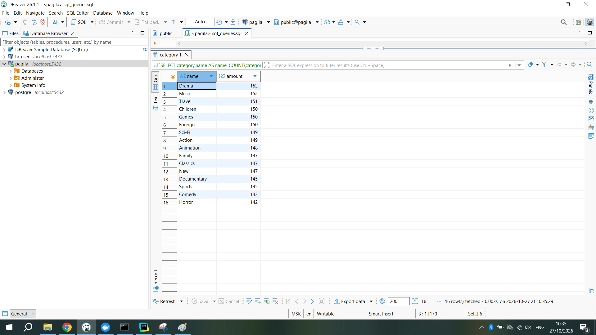
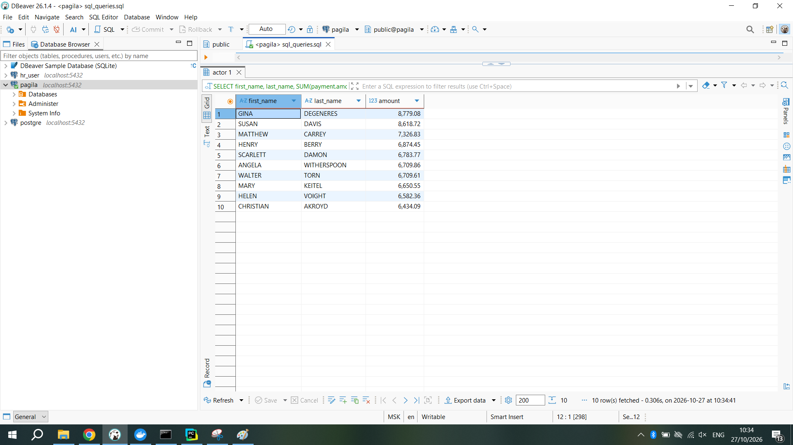
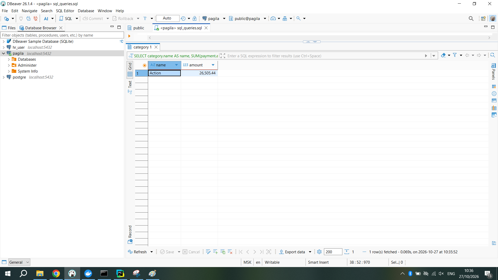
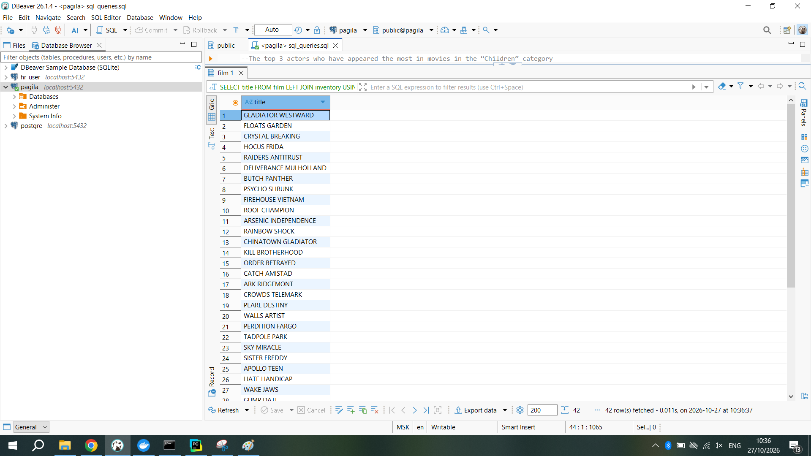
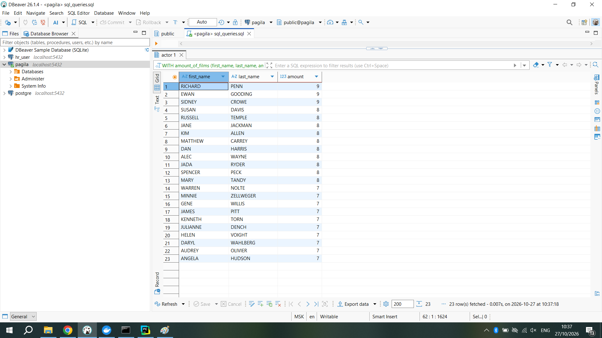
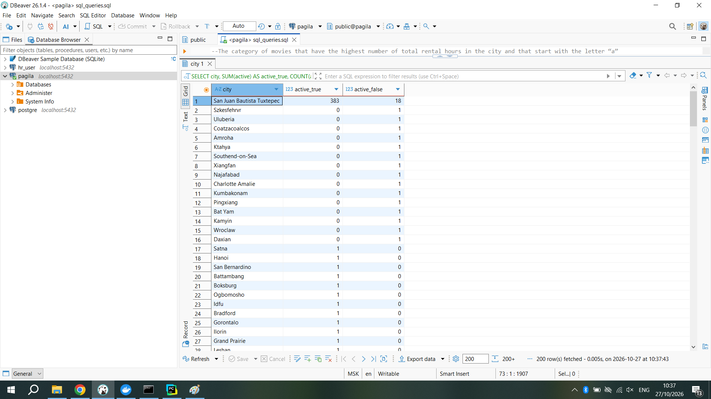
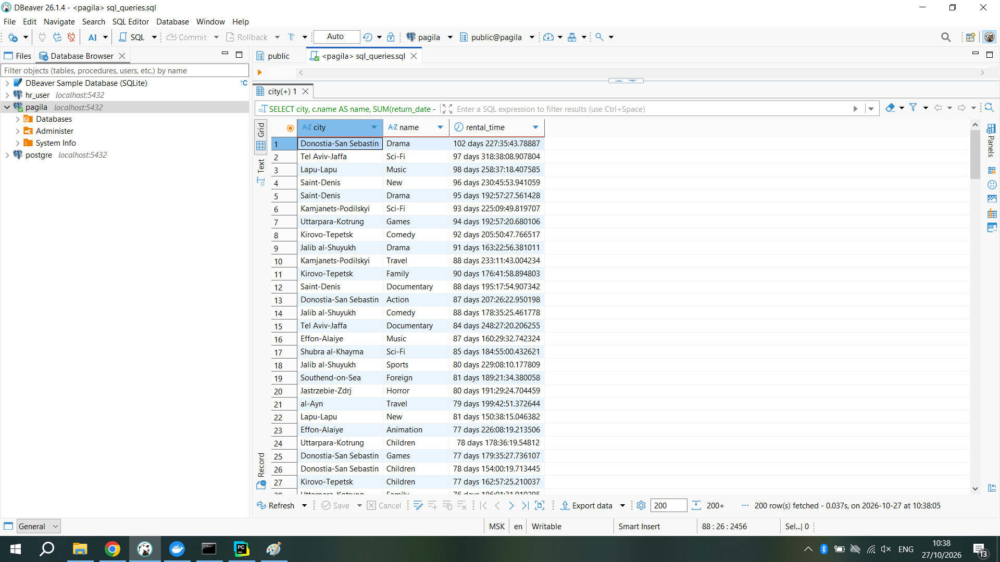

# SQL_task_pagila
This repository contains the solution for the SQL practical task using the Pagila demo database

**Task Overview**

1. Output the number of movies in each category, sorted descending: 

2. Output the 10 actors whose movies rented the most, sorted in descending order:

3. Output the category of movies on which the most money was spent:

4. Print the names of movies that are not in the inventory. Write a query without using the IN operator:

5. Output the top 3 actors who have appeared the most in movies in the “Children” category. If several actors have the same number of movies, output all of them:

6. Output cities with the number of active and inactive customers (active - customer.active = 1). Sort by the number of inactive customers in descending order:

7. Output the category of movies that have the highest number of total rental hours in the city (customer.address_id in this city) and that start with the letter “a”. Do the same for cities that have a “-” in them. Write everything in one query:
